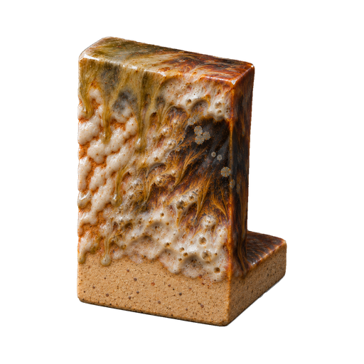

# Openglaze brand mark

A stoneware test tile dipped diagonally: crawled white shino with wood-ash runs on one side, tenmoku over shino with hare's-fur on the other, and an intermixed overlap band.

| File | Size | Use |
|---|---|---|
| `openglaze.png` | 1024×1024 | Master, transparent background |
| `openglaze-512.png` | 512×512 | README hero, app icon |
| `openglaze-192.png` | 192×192 | PWA and touch icon |
| `openglaze-32.png` | 32×32 | Favicon raster |

Part of the KyaniteLabs crystal icon family. Approved at the owner's eye-gate on 2026-11-10. Lockup: **OPENGLAZE** in Chakra Petch Bold 700 with "by KyaniteLabs" in Chakra Petch Medium 500. The reasoning is in `docs/DESIGN-PREFLIGHT.md`.
